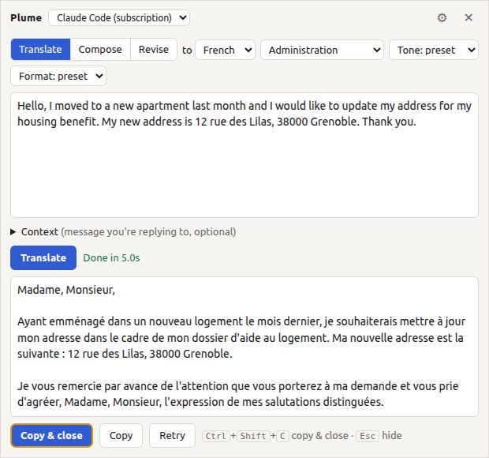

# Plume

Plume is a small Ubuntu desktop app for writing messages in a language you don't master yet.
Press a hotkey from any app, type what you want to say in English, pick a tone, and copy back
well-written French (or any other language). It saves switching to a translator tab and
explaining the tone every time.



- **Translate**: stays close to your own wording.
- **Compose**: you describe the message ("ask my landlord to fix the heating, politely") and it writes it.
- **Revise**: corrects grammar and tone without translating, for English or French you wrote yourself.
- **Presets**: saved tone, format and situation (Administration, Work email, Chat with colleagues…),
  editable in Settings. vous/tu follows the tone.
- **Context**: paste the message you're replying to so the answer fits it. It is never translated back.
- **Providers**: Claude Code (uses your Claude subscription), Anthropic API key, or OpenAI API key.

> Plume can't type into other apps. On Wayland, apps aren't allowed to type into other windows.
> You copy the result (`Ctrl+Shift+C`) and paste it with `Ctrl+V`.

## Requirements

- Ubuntu 22.04 or newer with GNOME (Wayland or X11). Other GNOME-based distros should work.
- One of:
  - [Claude Code](https://docs.claude.com/en/docs/claude-code) installed and logged in, to use a Claude subscription
  - an Anthropic API key
  - an OpenAI API key
- To build: Node.js 22.12 or newer.

## Install

```bash
git clone https://github.com/hquynguyen/plume.git
cd plume
npm install
npm run dist
sudo apt install ./dist/plume_0.1.0_amd64.deb
```

This installs to `/opt/Plume` and adds a `plume` command.

### Hotkey

GNOME doesn't let apps grab global keys on Wayland, so the hotkey is a GNOME custom shortcut that
runs `plume --toggle`. This script sets it to **Super+Alt+F** (Super is the Windows-logo key):

```bash
/opt/Plume/resources/install-shortcut.sh
```

To use a different key:

```bash
/opt/Plume/resources/install-shortcut.sh '<Ctrl><Alt>f'
```

Start Plume once, then tick **Start at login** in its tray menu so the hotkey opens it instantly.

## Use

| Key | Action |
| --- | --- |
| `Ctrl+Enter` | Run |
| `Ctrl+Shift+C` | Copy the result and hide the panel |
| `Esc` | Hide |

Open **Settings** (⚙ in the panel, or the tray menu) to pick a provider, add API keys, edit presets
and set output languages.

## Providers

| Provider | Needs | Billing |
| --- | --- | --- |
| Claude Code | Claude Code installed and logged in (`claude`, then `/login`) | Your Claude plan's usage limits |
| Anthropic API | Key from console.anthropic.com | Pay per use |
| OpenAI API | Key from platform.openai.com | Pay per use |

The Claude Code provider runs your own installed `claude` (from `~/.local/bin/claude` or `PATH`)
through the [Claude Agent SDK](https://docs.claude.com/en/docs/agent-sdk/overview), using the login
Claude Code already has. Plume never reads or stores your Claude credentials. Check that this personal
use fits your Claude plan's terms.

## Privacy and security

- Your text, and the context if you open that section, goes only to the provider you select. Nothing
  else leaves your machine. Plume has no telemetry.
- API keys are encrypted with the system keyring (Electron `safeStorage`, GNOME Keyring) in
  `~/.config/plume/keys.json`. If no keyring is available, Settings shows a warning.
- The windows never receive keys. The main process makes all provider calls, and the Anthropic client
  is pinned to `api.anthropic.com`.
- The text you paste may be untrusted, for example an email. So the Claude Code provider runs with no
  tools, no MCP servers, none of your Claude Code settings or hooks, and one turn. Every tool request
  is denied.
- The clipboard is read only when you press **Paste clipboard**.

Found a security issue? Please open a private
[security advisory](https://github.com/hquynguyen/plume/security/advisories/new) rather than a public issue.

## Develop

```bash
npm run dev        # run with hot reload
npm test           # unit tests (prompt builder, providers with mocked APIs)
npm run build      # typecheck + bundle
npm run dist       # build the .deb
```

The code is in `src/main` (Electron main process: window, IPC, settings, providers, prompt),
`src/preload` and `src/renderer` (panel and settings UI, plain TypeScript).

## License

[MIT](LICENSE)
